# rpi-k3s-homelab

[](https://github.com/teo-devops/rpi-k3s-homelab/actions/workflows/ci.yml)

Clúster Kubernetes (K3s) sobre tres Raspberry Pi **distintas** (8, 4 y 2 GB de RAM), construido paso a paso
y explicado para aprender. Ansible prepara los nodos, Cilium se encarga de la red, Flux aplica todo desde Git
y los servicios se exponen sin abrir puertos del router.

La idea central: **no hace falta hardware igual ni potente**. Con etiquetas, afinidad y reservas de memoria,
cada nodo hace lo que puede aguantar.

**Empieza por la guía: [docs/README.md](docs/README.md)**

## Hardware

| Nodo | Placa | RAM | Disco | Rol | Tier |
|------|-------|-----|-------|-----|------|
| `rpi5-8g` | Raspberry Pi 5 | 8 GB | SD 128 GB (NVMe en el futuro) | control plane | `large` |
| `rpi5-4g` | Raspberry Pi 5 | 4 GB | SD 128 GB (NVMe en el futuro) | worker | `medium` |
| `rpi4-2g` | Raspberry Pi 4 Model B | 2 GB | SD 128 GB | worker ligero | `small` |

Más un switch Gigabit, fuentes oficiales (o PoE+ con HAT) y disipador activo en las Pi 5.
Detalle y lista de material: [docs/01-hardware](docs/01-hardware/README.md).

## Arquitectura

<p align="center">
  
</p>

Fuente editable: [docs/diagramas/arquitectura.html](docs/diagramas/arquitectura.html).

| Capa | Herramienta | Por qué |
|------|-------------|---------|
| Sistema operativo | Raspberry Pi OS Lite 64 bits + **Ansible** | Reproducible: una SD rota se reconstruye en minutos |
| Kubernetes | **K3s**, 1 server con SQLite + 2 agents | Ligero y amable con las SD ([ADR 0001](docs/decisiones/0001-sqlite-vs-etcd.md)) |
| Red | **Cilium** (CNI, sin kube-proxy, LB-IPAM L2, Hubble) | eBPF, LoadBalancer sin MetalLB ([ADR 0006](docs/decisiones/0006-cilium-lb-vs-metallb.md)) |
| GitOps | **Flux** + SOPS/age, UI con **Headlamp** | Ligero; secretos cifrados en repo público ([ADR 0002](docs/decisiones/0002-flux.md), [0007](docs/decisiones/0007-headlamp-como-ui.md)) |
| Almacenamiento | **local-path** ahora, NVMe después, copias con Velero | Sin replicación pesada sobre SD ([ADR 0004](docs/decisiones/0004-local-path-ahora-nvme-despues.md)) |
| Exposición | **Traefik** + **cert-manager** (DNS-01), **Cloudflare Tunnel**, **Tailscale** | TLS válido sin abrir puertos ([ADR 0003](docs/decisiones/0003-tunnel-y-tailscale.md)) |
| Monitorización | **kube-prometheus-stack** ajustado | Métricas, temperatura de las Pi y alertas |
| Service mesh | **Cilium** sin sidecars, comparado con **Linkerd** | Aprender mTLS y L7 midiendo su coste ([ADR 0008](docs/decisiones/0008-service-mesh.md)) |

## Inicio rápido (fase 1)

Requisitos: SD flasheadas con Raspberry Pi OS Lite 64 bits, con tu clave SSH
([guía](docs/02-sistema-operativo/01-flashear-la-sd.md)), e IPs fijas por reserva DHCP
([guía](docs/03-red/02-reserva-dhcp.md)).

```bash
make check      # herramientas del portátil
make init       # crea ansible/inventory/hosts.yml: pon tus IPs
make deps       # colecciones de Ansible
make ping       # ¿llego a los tres nodos?
make prepare    # prepara SO, SSH, kernel, swap, SD... y reinicia si hace falta
make validate   # comprueba que están listos para K3s y Cilium
```

Paso a paso y explicado: [docs/04-ansible/04-preparar-los-nodos.md](docs/04-ansible/04-preparar-los-nodos.md).

## Inicio rápido (fase 2)

Edita antes el rango de IPs de LoadBalancer en
[`kubernetes/infrastructure/cilium/config/lb-ippool.yaml`](kubernetes/infrastructure/cilium/config/lb-ippool.yaml).

```bash
make k3s            # K3s: 1 server + 2 agents (quedan NotReady: aún no hay red)
make cilium         # Cilium: red, LoadBalancer en tu LAN, Hubble
make nodes          # los tres Ready, con su tier
make cilium-status
```

Guía: [docs/05-kubernetes-k3s](docs/05-kubernetes-k3s/README.md) y [docs/06-redes-cilium](docs/06-redes-cilium/README.md).

## Inicio rápido (fase 3)

Sube el repo a GitHub (público) y comprueba la URL en
[`gotk-sync.yaml`](kubernetes/clusters/homelab/flux-system/gotk-sync.yaml).

```bash
make flux           # Flux + clave SOPS; adopta Cilium e instala Headlamp desde Git
make flux-status    # todo Ready
make headlamp       # interfaz web en http://localhost:8080
```

Desde aquí, el clúster se cambia con `git push`. Guía: [docs/07-gitops-flux](docs/07-gitops-flux/README.md).

## Hoja de ruta

| Fase | Contenido | Estado |
|------|-----------|--------|
| 1 | Preparación de nodos con Ansible, documentación base | Hecho |
| 2 | K3s server/agents + Cilium (CNI, kube-proxy, LB-IPAM, Hubble) | Hecho |
| 3 | Flux, SOPS/age, Headlamp | Hecho |
| 4 | Almacenamiento: local-path con afinidad, copias con Velero | Pendiente |
| 5 | Traefik, cert-manager DNS-01, Cloudflare Tunnel, Tailscale | Pendiente |
| 6 | Monitorización y alertas | Pendiente |
| 7 | Service mesh | Pendiente |
| — | NVMe + Longhorn, Terraform para Cloudflare | Opcional |

## Estructura

```
ansible/        preparación de los nodos e instalación de K3s
kubernetes/     lo que corre dentro del clúster, aplicado por Flux
terraform/      Cloudflare como código (opcional)
scripts/        comprobaciones de apoyo
docs/           la guía, por temas
```

## Referencias

Este repo se inspira en [abhi1693/homelab](https://github.com/abhi1693/homelab),
[Spiev/k3s](https://github.com/Spiev/k3s) y
[este artículo de Michal Zindulka](https://medium.com/@michal.zindulka/my-homelab-journey-how-i-just-want-home-assistant-turned-into-a-kubernetes-cluster-feccd39a2817).

## Licencia

[MIT](LICENSE)
