# Arquitectura

## Objetivo

Ver el clúster completo antes de construirlo. Vuelve a esta página cuando te pierdas.

## Los nodos

| Nodo | Placa | Rol en K3s | Tier | Qué corre |
|------|-------|------------|------|-----------|
| `rpi5-8g` | Raspberry Pi 5, 8 GB | server (control plane) | `large` | API de Kubernetes, Flux, Prometheus, Grafana, Headlamp, Hubble |
| `rpi5-4g` | Raspberry Pi 5, 4 GB | agent | `medium` | Traefik, cert-manager, aplicaciones |
| `rpi4-2g` | Raspberry Pi 4, 2 GB | agent | `small` | Cargas ligeras: cloudflared, exporters |

El **tier** es una etiqueta (`homelab.io/tier`) que pondremos a cada nodo. Las aplicaciones la usan para
elegir dónde ejecutarse. Ver [presupuesto de memoria](../01-hardware/03-presupuesto-de-memoria.md).

## Capas

  

Fuente editable: [docs/diagramas/capas.html](../diagramas/capas.html).

Cada capa tiene su herramienta y su tema en la guía:

| Capa | Herramienta | Tema |
|------|-------------|------|
| Sistema operativo | Ansible | [02](../02-sistema-operativo/README.md), [04](../04-ansible/README.md) |
| Kubernetes | K3s + Cilium | [05](../05-kubernetes-k3s/README.md), [06](../06-redes-cilium/README.md) |
| Plataforma y aplicaciones | Flux (GitOps) | [07](../07-gitops-flux/README.md) en adelante |
| DNS público y túnel | Terraform (opcional) | [09](../09-exposicion-y-seguridad/README.md) |

## Cómo llega el tráfico

Hay tres caminos, y cada uno tiene un propósito distinto:

  

Fuente editable: [docs/diagramas/arquitectura.html](../diagramas/arquitectura.html).

1. **Desde casa**: el DNS local resuelve `*.home.example.com` a la IP de Traefik. Certificado válido de
   Let's Encrypt obtenido por DNS-01, sin exponer nada.
2. **Tú desde fuera**: Tailscale (VPN) te mete en la red de casa. Mismas URLs que en casa.
   Aquí van las herramientas de administración: Grafana, Headlamp, Hubble, la API de Kubernetes.
3. **Cualquiera desde internet** (solo lo que tú elijas): Cloudflare Tunnel. `cloudflared` abre una
   conexión **saliente** hacia Cloudflare, así que el router no necesita abrir ningún puerto.

Detalle en [decisión 0003](../decisiones/0003-tunnel-y-tailscale.md).

## Direcciones de ejemplo

| Qué | Rango |
|-----|-------|
| Red de casa | `192.168.1.0/24` |
| Nodos (reserva DHCP) | `192.168.1.11` a `.13` |
| Servicios LoadBalancer (Cilium) | `192.168.1.200` a `.220` |
| Pods | `10.42.0.0/16` |
| Services internos | `10.43.0.0/16` |

Adáptalas a tu red siguiendo [03 · Red](../03-red/01-plan-de-direcciones.md).

---
Anterior: [02 · Qué vas a aprender](02-que-vas-a-aprender.md) · [Índice del tema](README.md) · Siguiente: [04 · Convenciones](04-convenciones.md)
