# Qué es un CNI

## Objetivo

Entender qué problema resuelve la red de pods y qué piezas sustituye Cilium.

## Conceptos

Kubernetes impone un modelo de red sencillo de enunciar:

1. Cada pod tiene su propia IP.
2. Cualquier pod puede hablar con cualquier otro por su IP, esté en el nodo que esté, sin NAT.

Kubernetes **no** implementa ese modelo: delega en un plugin **CNI** (Container Network Interface). Cuando
el kubelet arranca un pod, llama al CNI, que crea la interfaz de red del pod, le asigna una IP y se asegura
de que el resto del clúster sepa llegar a ella.

Además del CNI hacen falta otras tres piezas de red. En este lab, Cilium las cubre todas:

| Necesidad | Pieza clásica | En este lab |
|-----------|---------------|-------------|
| IP y conectividad de pods | Flannel, Calico... | Cilium |
| Services (una IP estable delante de varios pods) | kube-proxy con iptables | Cilium con eBPF |
| Filtrar tráfico (NetworkPolicy) | Calico, controlador de K3s | Cilium |
| LoadBalancer en bare metal | MetalLB, ServiceLB | Cilium LB-IPAM + L2 |
| Ver el tráfico | tcpdump a mano | Hubble |

## El camino de un paquete

Un pod en `rpi4-2g` (IP `10.42.2.15`) llama a otro en `rpi5-8g` (IP `10.42.0.30`):

  

Fuente editable: [docs/diagramas/paquete.html](../diagramas/paquete.html).

Cada nodo tiene su trozo del rango de pods (`10.42.0.0/24`, `10.42.1.0/24`...) y una ruta a los trozos de
los demás. Como los tres nodos están en el mismo switch, el paquete viaja tal cual: es el **enrutado
nativo** que configuramos. La alternativa, el **túnel** (VXLAN), envuelve cada paquete en otro para cruzar
redes que no conocen las IPs de pods; cuesta CPU y bytes, y aquí no hace falta.

---
[Índice del tema](README.md) · Siguiente: [02 · eBPF en cinco minutos](02-ebpf.md)
