# Qué es GitOps

## Objetivo

Entender qué cambia al pasar a GitOps y por qué merece la pena.

## Conceptos

Hasta ahora has cambiado el clúster con comandos: `make cilium`, `kubectl apply`. Funciona, pero tiene
tres problemas:

1. **Nadie sabe qué hay instalado** salvo mirando el propio clúster. Si se rompe, ¿cómo lo reconstruyes?
2. **Los cambios no dejan rastro**: quién cambió qué, cuándo y por qué.
3. **Las desviaciones se acumulan**: un `kubectl edit` de prueba que se queda olvidado.

**GitOps** invierte el flujo. Git es la **fuente de verdad**: el estado deseado del clúster está escrito en
el repo. Un agente dentro del clúster (Flux) lo compara continuamente con el estado real y corrige las
diferencias.

  

Fuente editable: [docs/diagramas/gitops.html](../diagramas/gitops.html).

| Antes | Con GitOps |
|-------|------------|
| `kubectl apply -f x.yaml` | Commit de `x.yaml` y push |
| Deshacer: recordar qué había | `git revert` |
| ¿Qué hay instalado? Mirar el clúster | Leer `kubernetes/` |
| Reconstruir tras un desastre: memoria | Instalar Flux y esperar |
| `kubectl edit` se queda para siempre | Flux lo revierte en el siguiente ciclo |

Fíjate en el sentido de las flechas: Flux **tira** de Git (modelo *pull*). Nada de fuera necesita acceso
al clúster: ni GitHub, ni un sistema de CI. Para un clúster en casa, detrás del router, es justo lo que
queremos.

## Las piezas de Flux

| Controlador | Qué hace | Tipos de recurso |
|-------------|----------|------------------|
| source-controller | Descarga Git y repositorios de Helm | `GitRepository`, `HelmRepository` |
| kustomize-controller | Aplica manifiestos (con Kustomize) | `Kustomization` |
| helm-controller | Instala y actualiza charts de Helm | `HelmRelease` |
| notification-controller | Avisos y webhooks | `Alert`, `Provider`, `Receiver` |

Ojo con el nombre: la `Kustomization` de Flux (`kustomize.toolkit.fluxcd.io`) es un recurso del clúster que
dice "aplica esta carpeta". El `kustomization.yaml` de Kustomize es un fichero que dice "esta carpeta
contiene estos manifiestos". Se usan juntos y se llaman casi igual: es la confusión número uno al empezar.

---
[Índice del tema](README.md) · Siguiente: [02 · Estructura de kubernetes/](02-estructura.md)
