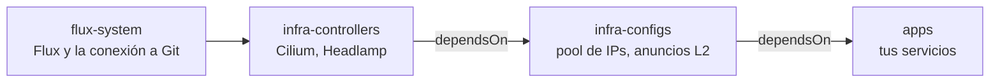

# Estructura de kubernetes/

## Objetivo

Saber qué hay en cada carpeta y en qué orden lo aplica Flux.

## Conceptos

```
kubernetes/
├── clusters/homelab/              <- punto de entrada: Flux empieza aquí
│   ├── flux-system/               <- Flux se gestiona a sí mismo
│   │   ├── gotk-components.yaml   (generado: los controladores de Flux)
│   │   ├── gotk-sync.yaml         (de qué repo y rama leer)
│   │   └── kustomization.yaml     (parche: Flux al nodo large)
│   ├── infrastructure.yaml        <- Kustomizations infra-controllers e infra-configs
│   └── apps.yaml                  <- Kustomization apps
├── infrastructure/
│   ├── controllers/               <- capa 1: lista de componentes
│   ├── configs/                   <- capa 2: su configuración
│   ├── cilium/                    (HelmRelease + values.yaml + config/)
│   └── headlamp/                  (HelmRelease + permisos)
├── apps/                          <- tus aplicaciones
└── examples/                      <- para practicar; Flux NO los aplica
```

### El orden importa

Algunas cosas solo se pueden aplicar cuando otras existen. El pool de IPs de Cilium
(`CiliumLoadBalancerIPPool`) es un tipo de recurso que **crea Cilium**: si Flux intentara aplicarlo antes de
que Cilium esté instalado, fallaría. Por eso hay capas encadenadas con `dependsOn`:



Con `wait: true`, una capa no se da por buena hasta que todo lo que aplicó está sano (pods arrancados,
HelmRelease instaladas). Solo entonces empieza la siguiente.

### Opciones comunes de cada Kustomization

[`infrastructure.yaml`](../../kubernetes/clusters/homelab/infrastructure.yaml):

| Opción | Qué hace |
|--------|----------|
| `path` | Carpeta del repo que aplica |
| `interval: 10m` | Cada 10 min vuelve a aplicar, aunque Git no cambie: corrige desviaciones |
| `prune: true` | Si borras algo de Git, lo borra del clúster |
| `wait: true` | Espera a que todo esté sano |
| `dependsOn` | No empieza hasta que otra Kustomization esté lista |
| `decryption` | Descifra con SOPS ([05](05-secretos-sops.md)) |
| `postBuild.substituteFrom` | Sustituye `${VARIABLE}` por valores de un ConfigMap que no está en Git |

### Variables fuera de Git

La IP del API server es necesaria para Cilium pero es de tu red. En vez de escribirla en el repo, el
manifiesto dice `${K8S_SERVICE_HOST}` y Flux la sustituye con el ConfigMap `flux-system/cluster-vars`, que
crea `make flux` a partir de tu kubeconfig. Es el patrón para todo lo que dependa de tu instalación concreta.

---
Anterior: [01 · Qué es GitOps](01-que-es-gitops.md) · [Índice del tema](README.md) · Siguiente: [03 · Bootstrap](03-bootstrap.md)
