# Secretos con SOPS

## Objetivo

Guardar contraseñas y tokens en el repo público, cifrados, y que Flux los descifre al aplicarlos.

## Conceptos

Un `Secret` de Kubernetes **no está cifrado**: sus valores van en base64, que es una codificación, no un
cifrado. Subirlo a un repo público es publicarlo. Y borrarlo después no sirve: queda en el historial de Git.

**SOPS** cifra solo los valores de un fichero YAML y deja el resto legible. **age** es el sistema de claves:

| Clave | Dónde vive | Para qué |
|-------|------------|----------|
| Pública (`age1...`) | `.sops.yaml` en la raíz del repo | Cifrar. Cualquiera puede cifrar para ti |
| Privada | `~/.config/sops/age/rpi-k3s-homelab.agekey` en tu portátil, y el Secret `flux-system/sops-age` | Descifrar. Solo tú y Flux |

<p align="center">
  
</p>

<sub>Fuente editable: [docs/diagramas/sops.html](../diagramas/sops.html).</sub>

Las reglas de `.sops.yaml` (lo escribe [`sops-init.sh`](../../scripts/sops-init.sh) al ejecutar `make sops-init`):

- Solo ficheros que terminan en `.sops.yaml` dentro de `kubernetes/`.
- Solo se cifran `data` y `stringData`. Nombre, namespace y tipo quedan legibles, para que los diffs de Git
  tengan sentido.

Las Kustomizations de Flux tienen `decryption: provider: sops`: descifran al vuelo antes de aplicar.

## Pasos

1. Si no lo hizo ya `make flux`: `make sops-init`.
2. Crea un secreto de prueba a partir de la plantilla:

   ```bash
   mkdir -p kubernetes/apps/demo
   cp kubernetes/examples/secreto.yaml kubernetes/apps/demo/secreto.sops.yaml
   $EDITOR kubernetes/apps/demo/secreto.sops.yaml      # pon tus valores
   make sops-encrypt FILE=kubernetes/apps/demo/secreto.sops.yaml
   ```

3. Mira el resultado: los valores son ahora `ENC[AES256_GCM,...]` y hay un bloque `sops:` al final.
4. Para editarlo más tarde, sin pasar por un fichero en claro:

   ```bash
   SOPS_AGE_KEY_FILE=~/.config/sops/age/rpi-k3s-homelab.agekey sops kubernetes/apps/demo/secreto.sops.yaml
   ```

5. Para que Flux lo aplique, el namespace `demo` debe existir y la carpeta debe estar en
   [`apps/kustomization.yaml`](../../kubernetes/apps/kustomization.yaml). Lo verás completo en
   [07 · Flujo de trabajo](07-flujo-de-trabajo.md).

## Red de seguridad

`make lint` ejecuta [`check-unencrypted-secrets.sh`](../../scripts/check-unencrypted-secrets.sh): falla si
encuentra en `kubernetes/` un `kind: Secret` sin bloque `sops:`. Ejecútalo antes de cada push.

## Comprobación

```bash
grep -c ENC kubernetes/apps/demo/secreto.sops.yaml      # mayor que 0
kubectl -n demo get secret secreto-demo -o jsonpath='{.data.usuario}' | base64 -d   # tras sincronizar
```

## Si pierdes la clave privada

No hay forma de recuperar los secretos cifrados. Crea una clave nueva (borra la vieja y `make sops-init`),
vuelve a escribir cada secreto y cífralo otra vez. Por eso la copia en el gestor de contraseñas es obligatoria.

---
Anterior: [04 · Flux adopta Cilium](04-flux-adopta-cilium.md) · [Índice del tema](README.md) · Siguiente: [06 · Headlamp](06-headlamp.md)
